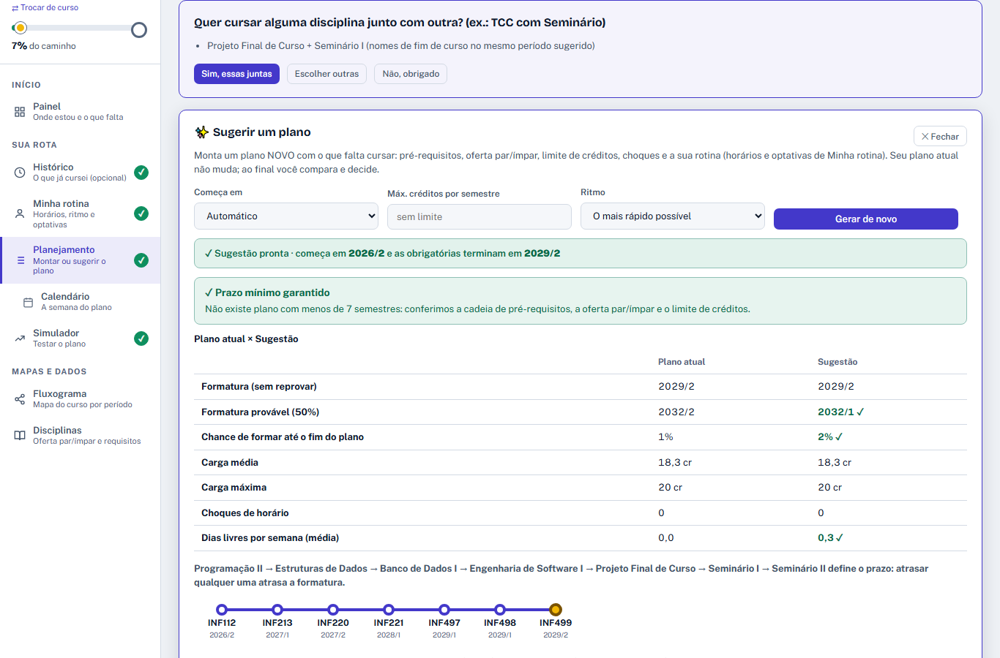
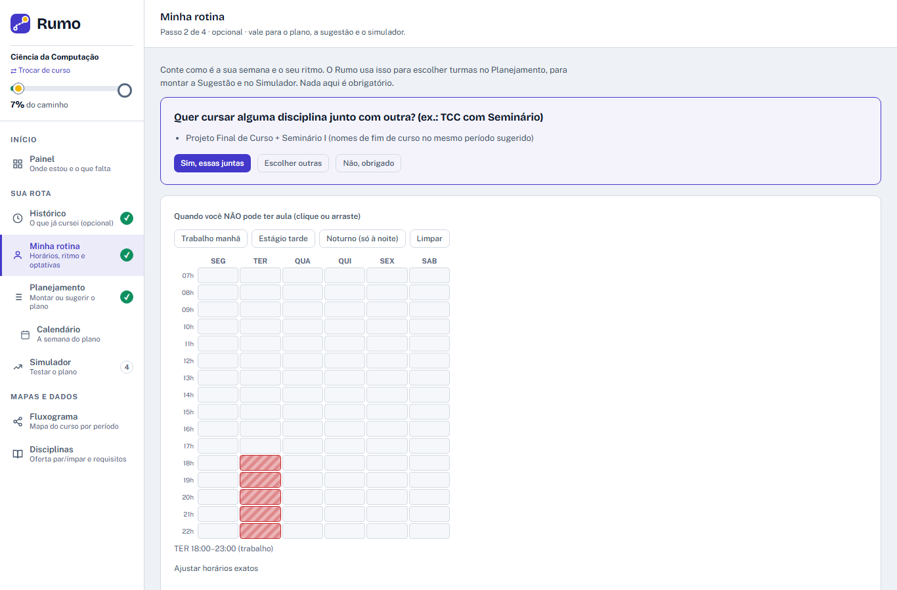
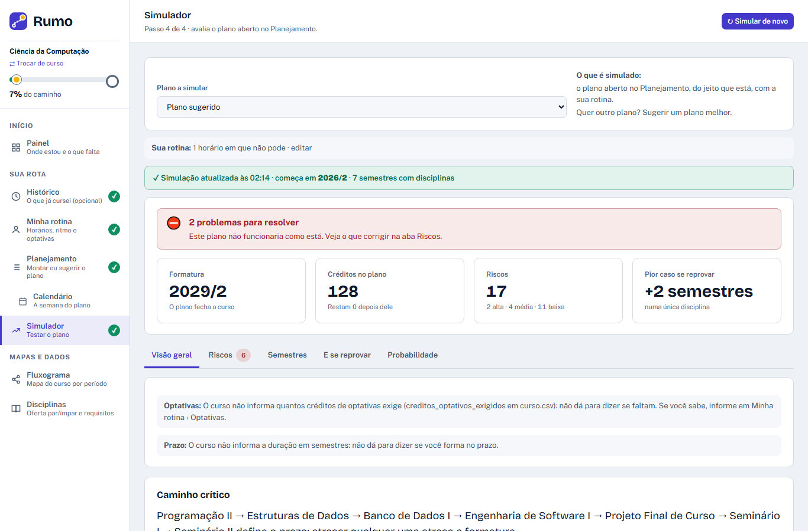
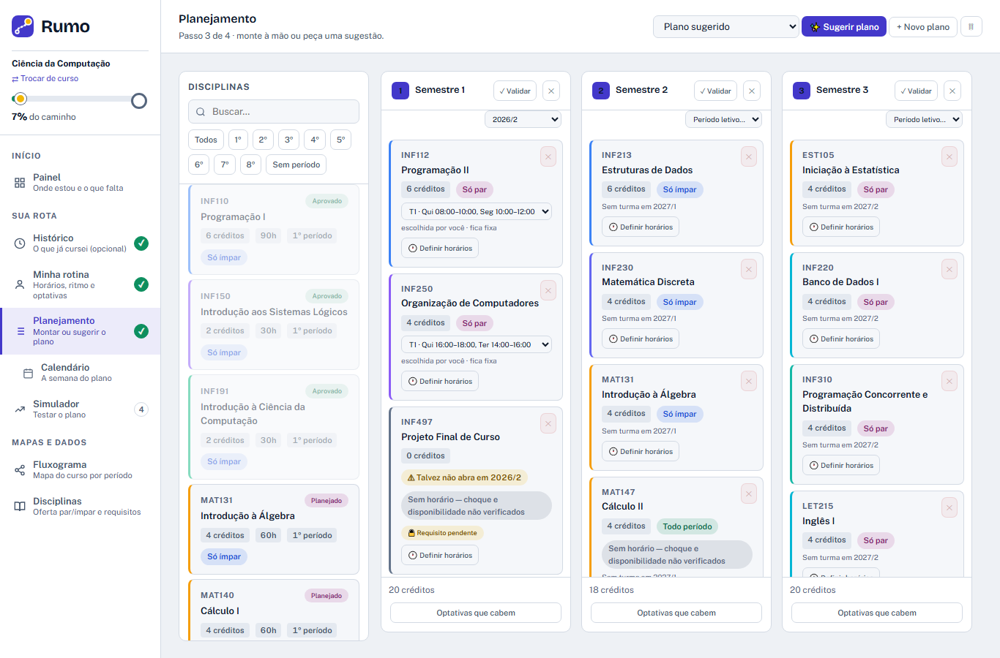
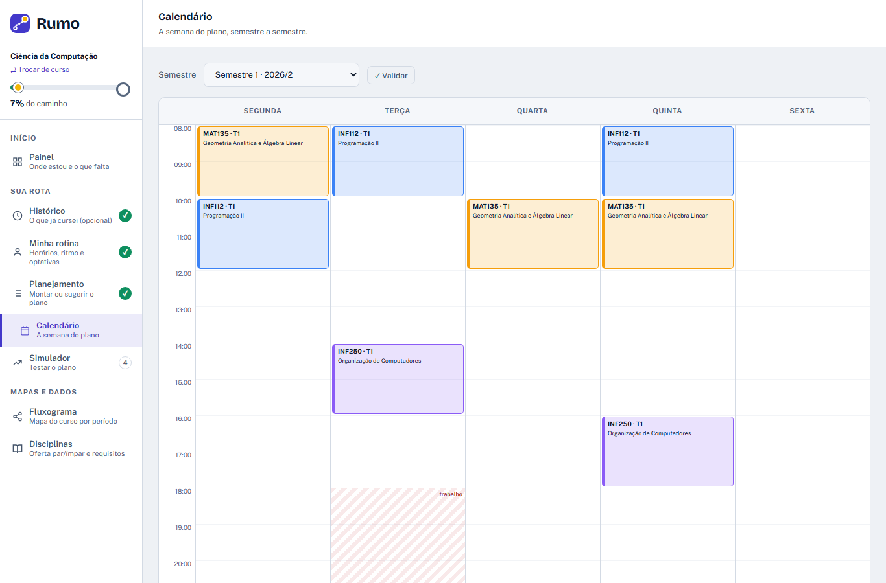

<div align="center">

# 🧭 Rumo

**O planejador acadêmico que mostra o caminho até a formatura.**

Traga a matriz do seu curso, conte o que já cursou e como é a sua semana:
o Rumo monta o plano, escolhe as turmas que cabem na sua rotina e diz quando você forma — e o que pode dar errado.


</div>

<p align="center">
  <picture>
    <source media="(prefers-color-scheme: dark)" srcset="docs/capturas/arquitetura/planner-sugestao-1366-dark.png">
    
  </picture>
</p>

---

## ✨ O que ele faz

| | |
|---|---|
| 📥 **Traga o seu curso** | Matriz curricular por CSV (disciplinas, créditos, pré/correquisitos, oferta par/ímpar e turmas), com prévia antes de gravar. Não tem as planilhas? A tela gera um texto pronto para uma IA montá-las a partir do PDF do curso. |
| ✏️ **Corrija na tela** | Edite qualquer disciplina — código, créditos, oferta, requisitos — ou crie uma nova, com **Desfazer**. Pré-requisitos em círculo são recusados. |
| 📜 **Histórico** *(opcional)* | Marque o que já cursou ou **cole a tabela** do sistema acadêmico (também aceita CSV). |
| 🗓️ **Minha rotina** *(opcional)* | Pinte na grade os horários em que não pode ter aula (trabalho, estágio). O Rumo responde na hora: *“com a sua rotina, 3 obrigatórias não cabem”*. |
| ✨ **Sugerir plano** | Um otimizador monta o plano mais curto possível respeitando pré-requisitos, oferta par/ímpar, limite de créditos, choques, sua rotina, TCC no fim, disciplinas que andam juntas e espaço para optativas no meio do curso. Quando prova que não dá para formar antes, mostra o selo **prazo mínimo garantido**. |
| 🧩 **Planejamento** | Arraste disciplinas entre semestres. O Rumo escolhe a **melhor combinação de turmas** do semestre (você pode trocar) e marca choques, requisitos faltando e sobrecarga. |
| 📅 **Calendário** | A semana de cada semestre; nos futuros, sem quadro publicado, mostra o horário estimado. No celular vira lista por dia. |
| 🔮 **Simulador** | Testa o plano: formatura prevista, riscos semestre a semestre, *“e se eu reprovar?”* e a chance de formar no prazo (Monte Carlo). |

<details>
<summary><b>Casos do mundo real que ele trata</b></summary>

- **Oferta par/ímpar** — disciplina que só abre em 2027/1, 2028/1… (cadastrada ou estimada pelo período sugerido, sempre sinalizada).
- **Quadro de horários publicado** — se o período já tem quadro e a disciplina não está nele, ela não é sugerida ali.
- **Teórica + prática separadas** — coluna `componente` em `turmas.csv`: a matrícula vira uma teórica + uma prática do mesmo período, combinadas sem choque.
- **Estágio/TCC com muitos créditos e pouca aula** — marque *“não conta no limite de créditos”*: conta para formar, não ocupa o semestre.
- **TCC I / TCC II, Seminários** — ficam nos últimos semestres, na ordem certa.
- **Cursar junto** (ex.: TCC com Seminário) e **disciplina num período específico** — pedidos que a sugestão respeita, dizendo quanto custam na formatura.
- **Trancamento, teto de créditos por período, disciplinas pesadas, turno e dias livres.**
- **Dado desconhecido nunca vira zero** — o que o curso não informa aparece como “não informado” e vira premissa explícita.

</details>

## 📸 Telas

<table>
  <tr>
    <td width="50%"></td>
    <td width="50%"></td>
  </tr>
  <tr>
    <td align="center"><b>Minha rotina</b> · marque quando não dá</td>
    <td align="center"><b>Simulador</b> · o plano funciona?</td>
  </tr>
  <tr>
    <td></td>
    <td></td>
  </tr>
  <tr>
    <td align="center"><b>Planejamento</b> · turmas escolhidas pelo Rumo</td>
    <td align="center"><b>Calendário</b> · a semana do semestre</td>
  </tr>
</table>

Funciona no celular, em tema claro e escuro.

---

## 🚀 Rodando localmente

```bash
pip install -r requirements-dev.txt
flask --app planner db upgrade        # cria/atualiza o banco (SQLite em instance/)
flask --app planner run --debug       # http://127.0.0.1:5000
```

Sem Supabase configurado, o login usa o provedor **`dev`**: qualquer e-mail entra. Para testar com um curso de verdade,
importe os arquivos de [`examples/ciencia-da-computacao/`](examples/ciencia-da-computacao/).

<details>
<summary><b>Login com Supabase (sem senha)</b></summary>

1. Copie `.env.example` para `.env` e preencha `SUPABASE_URL` e `SUPABASE_ANON_KEY`.
2. No painel do Supabase, em **Authentication → URL Configuration → Redirect URLs**, adicione
   `http://127.0.0.1:5000/entrar` (e a URL de produção + `/entrar`).
3. Para o código de 6 dígitos funcionar, inclua `{{ .Token }}` no template do e-mail (**Authentication → Email Templates**).

Já tinha cursos importados antes do login existir? `flask --app planner reivindicar-cursos SEU@EMAIL`.

</details>

<details>
<summary><b>Produção</b></summary>

Variáveis obrigatórias: `SECRET_KEY`, `DATABASE_URL`, `SUPABASE_URL` (https), `SUPABASE_ANON_KEY` e `AUTH_PROVEDOR=supabase`.
Passo a passo (Supabase + Vercel) em [`docs/DEPLOY.md`](docs/DEPLOY.md). Depois de atualizar o código, aplique as migrações:

```bash
flask --app planner db upgrade
```

</details>

## 🧪 Testes

```bash
pytest                                   # toda a suíte
pytest tests/test_domain_pureza.py       # garante que o domínio não depende de Flask/banco
python tools/medir_otimizador.py         # desempenho do otimizador no curso de exemplo
```

As telas têm roteiros de validação com Playwright em [`tools/validacao_ui/`](tools/validacao_ui/).

## 🏗️ Arquitetura

```
planner/
├── domain/        regras puras (só stdlib): grafos de requisitos, otimizador, alocação de turmas,
│                  simulador, Monte Carlo, prazo, rotina — testáveis sem banco
├── services/      casos de uso; *_json.py traduzem para a tela (textos prontos em português)
├── repositories/  único lugar com SQL
├── api/           rotas Flask (só HTTP ⇄ services)
├── importers/     leitura e validação dos CSVs
├── models/        SQLAlchemy + migrações Alembic em migrations/
└── static/, templates/   front em JavaScript puro, sem build
```

<details>
<summary><b>Como a sugestão de plano funciona</b></summary>

1. **Grafo de requisitos** → caminho crítico com o calendário de oferta (par/ímpar, quadro publicado, trancamentos).
2. **Limites inferiores** (cadeia, energia de créditos, janelas por oferta) dizem o mínimo de semestres possível.
3. **Guloso por prioridade** (altura no grafo + peso posicional) monta uma primeira solução; o plano atual do aluno entra como ponto de partida.
4. **Recozimento simulado** com custo incremental, vizinhanças viáveis, reaquecimento e reinícios — semente fixa, resultado determinístico.
5. **Branch & bound** escolhe as turmas de cada semestre: primeiro zero choques, depois a sua rotina.

Se a solução encontrada bate o limite inferior, o selo **prazo mínimo garantido** aparece.

</details>

<details>
<summary><b>Migrações</b></summary>

```bash
flask --app planner db migrate -m "descrição"   # gera migração após mudar um modelo
flask --app planner db upgrade                  # aplica
flask --app planner db check                    # falha se modelos e migrações divergirem
```

</details>

## 📚 Documentação

| Documento | Conteúdo |
|---|---|
| [`docs/PROGRESSO.md`](docs/PROGRESSO.md) | o que foi feito, fase a fase, e os limites conhecidos |
| [`docs/IMPORTACAO.md`](docs/IMPORTACAO.md) | formato dos CSVs (curso, disciplinas, requisitos, turmas) |
| [`docs/ARQUITETURA.md`](docs/ARQUITETURA.md) | camadas, modelo de dados e decisões |
| [`docs/DEPLOY.md`](docs/DEPLOY.md) | publicar com Supabase + Vercel |

<sub>O app original está preservado em `legacy/` só para testes de caracterização · `python -m tools.export_legacy_seed` regenera os CSVs de exemplo.</sub>
